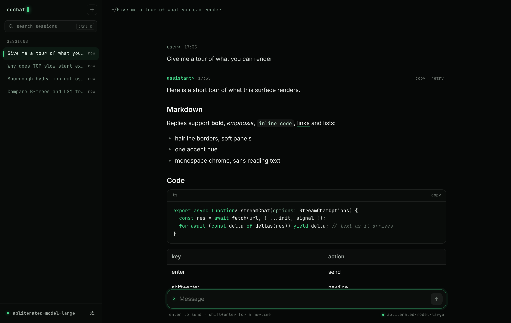

# ogchat

A personal AI chat interface that runs entirely on your machine. Multi-session
chat with streaming replies, local history, and one configurable
OpenAI-compatible provider. No accounts, no cloud, no telemetry.



More screens: [first run](docs/screens/01-first-run.png) ·
[streaming](docs/screens/02-streaming.png) ·
[inline error](docs/screens/04-inline-error.png) ·
[settings](docs/screens/05-settings.png) ·
[mobile](docs/screens/06-mobile.png)

## Run it

Requires Node.js 20.9 or newer.

```bash
npm install
npm run dev
```

Open http://127.0.0.1:3000. With no key configured the app still works: the
empty state points you at settings. For a faster, production build:

```bash
npm run build
npm start
```

Both commands bind to 127.0.0.1 only.

### Try it without a real key

```bash
npm run mock-provider
```

This starts a stand-in provider at `http://127.0.0.1:8787/v1`. In settings, set
the base URL to that address and enter any key. Messages starting with
`/error`, `/empty`, `/slow` or `/drop` exercise the failure paths; the key
`bad` is rejected as invalid.

## Provider configuration

Three values: API base URL, API key, model id. Set them in either place:

| Where          | How                                                                                                                                   |
| -------------- | ------------------------------------------------------------------------------------------------------------------------------------- |
| Settings panel | Gear button at the bottom of the sidebar. Saved to `data/settings.json`.                                                              |
| `.env.local`   | `cp .env.example .env.local`, then fill in `OGCHAT_API_BASE_URL`, `OGCHAT_API_KEY`, `OGCHAT_MODEL`. Restart the server after editing. |

Per field, the settings panel wins over `.env.local`, which wins over the
defaults:

- base URL `https://api.abliteration.ai/v1`
- model `abliterated-model-large`

The provider must speak the OpenAI chat-completions shape:
`POST {base}/chat/completions` with `Authorization: Bearer <key>` and
`user` / `assistant` / `system` roles.

### Where the API key lives

- **Entered in the settings panel:** written to `data/settings.json` on this
  machine, in a file readable only by your user (mode 600).
- **From `.env.local`:** stays in that file and the server process. It is never
  copied into `data/`.
- Both `data/` and `.env.local` are gitignored. `.env.example` holds names only.
- The key never returns to the browser. The API reports it masked
  (`••••••••a1b2`), and the settings field is write-only.
- The key is never logged. Provider failures are logged with the masked form,
  and error text from the provider is scrubbed in case it echoes the key back.
- All provider calls are made by the server (`/api/...` routes); the browser
  talks only to ogchat.

## Using it

| Key                             | Action                                             |
| ------------------------------- | -------------------------------------------------- |
| Enter                           | Send                                               |
| Shift+Enter                     | Newline                                            |
| Esc                             | Stop the reply in progress                         |
| Cmd/Ctrl+K                      | Focus session search (Enter opens the first match) |
| Double-click or F2 on a session | Rename                                             |

- Sessions are titled from their first message and listed most recently active
  first. Search matches titles and message text.
- A session is saved on its first message, so "new session" never leaves empty
  entries behind.
- Hover the last message you sent to edit or delete it; hover the last reply to
  copy or retry it. Editing replaces the message and its reply, then asks again.
- Stopping keeps the text received so far, marked `— stopped`.
- A reply keeps generating on the server if you switch sessions or close the
  tab, and is there when you come back. Only Stop ends it early.
- Provider errors, an invalid key, an empty reply and network loss all appear
  inline with a retry. Your message is saved before the provider is called, so
  a failure never costs you the session.

## Data

Everything is plain JSON under `data/` (override with `OGCHAT_DATA_DIR`):

```
data/
  settings.json            provider settings, including a key saved in the panel
  sessions/<id>.json       one file per session: title, timestamps, messages
```

Back up or move the folder to keep your history. Delete it to start clean.

## Layout

```
src/
  app/
    page.tsx, layout.tsx           mounts the shell
    api/sessions/...               session + message routes (NDJSON streaming)
    api/settings/route.ts          provider settings (key masked)
  components/
    chat/                          the chat surface: transcript, composer, markdown
    shell/                         the app shell: sidebar, top bar, settings panel
  lib/
    provider/adapter.ts            the only module that talks to the provider
    server/                        persistence, settings, turn handling, request guard
    client/api.ts                  browser client for the routes above
tests/                             vitest: persistence, adapter, route contract
scripts/mock-provider.mjs          stand-in provider for local trials
```

### Changing provider

All provider traffic goes through `src/lib/provider/adapter.ts`
(`streamChat`). A provider with a different wire format needs changes in that
file only; base URL and model are settings, never hardcoded at call sites.

### Embedding the chat surface

The chat surface and the app shell are separate. `ChatSurface` needs the API
routes and a parent with a height, nothing from the shell:

```tsx
import { ChatSurface } from "@/components/chat";

<div style={{ height: 600 }}>
  <ChatSurface
    sessionId={sessionId} // null starts a new conversation
    apiBase="/api" // where the ogchat routes are mounted
    provider={{ ready: true, model: "abliterated-model-large" }}
    onSessionCreated={(session) => setSessionId(session.id)}
  />
</div>;
```

Its styles are scoped to the `.ogchat` class; the design tokens (colors, fonts,
radii) are CSS variables in `src/components/chat/theme.css`.

## API

| Route                                          | Purpose                                                                                                                       |
| ---------------------------------------------- | ----------------------------------------------------------------------------------------------------------------------------- |
| `GET /api/sessions?q=`                         | List sessions, optionally filtered                                                                                            |
| `POST /api/sessions`                           | Create a session                                                                                                              |
| `GET /api/sessions/:id`                        | Session with messages, plus `generating` / `partial`                                                                          |
| `PATCH /api/sessions/:id`                      | Rename `{ title }`                                                                                                            |
| `DELETE /api/sessions/:id`                     | Delete                                                                                                                        |
| `POST /api/sessions/:id/messages`              | Send `{ content, replaceFromMessageId? }` or `{ regenerate: true }`; streams NDJSON events `start`, `delta`, `done` / `error` |
| `DELETE /api/sessions/:id/messages/:messageId` | Delete a user message and everything after it                                                                                 |
| `POST /api/sessions/:id/stop`                  | Stop the reply in progress                                                                                                    |
| `GET` / `PUT /api/settings`                    | Read (masked) / update provider settings                                                                                      |

There is no login, so the API only answers requests addressed to a loopback
host and refuses state-changing requests from other origins. To serve ogchat
under another hostname, list it in `OGCHAT_ALLOWED_HOSTS` and pass your own
`-H` to `next dev` / `next start`. Do that only on a network you trust: anyone
who can reach the port can use your key.

## Development

```bash
npm run typecheck    # next typegen + tsc --noEmit
npm test             # vitest, provider stubbed, no network
npm run format       # prettier
```

Tests never touch the network: `fetch` is replaced with a stub provider, and
every test runs against its own temporary data directory.

Next.js' anonymous usage telemetry is switched off in `next.config.ts`.
